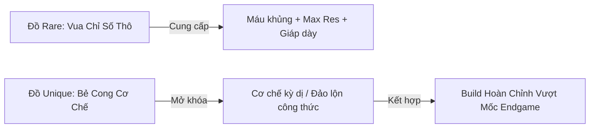

# 11. Thiết Kế Toàn Diện Hệ Thống Trang Bị (Equipment System Specification)

**Tài liệu Thiết kế Hệ thống (GDD - System Specification)**  
**Dự án:** *Idle Exile*  
**Vị trí:** Senior Game Designer / Systems & Combat Architect  
**Form Factor:** Mini-Window Desktop Companion (`440 x 780` px)  
**Tài liệu liên kết:** [05_items_and_crafting.md](05_items_and_crafting.md) | [09_weapon_equipment_system.md](09_weapon_equipment_system.md) | [03_combat_and_stats.md](03_combat_and_stats.md)

---

## 1. TỔNG QUAN & TRIẾT LÝ THIẾT KẾ CỐT LÕI (CORE DESIGN PILLARS)

Hệ thống trang bị trong **Idle Exile** được thiết kế nhằm tái tạo cảm giác phấn khích tột độ khi tối ưu hóa số liệu (theorycrafting) của *Path of Exile*, nhưng đồng thời được tinh gọn tuyệt đối để vận hành hoàn hảo trên giao diện mini-window chạy nền không chiếm dụng thao tác tay của người chơi (*Zero APM*).

```
┌────────────────────────────────────────────────────────────────────────┐
│               5 TRỤ CỘT THIẾT KẾ HỆ THỐNG TRANG BỊ                    │
├──────────────────────────┬─────────────────────────────────────────────┤
│ 1. Decoupled Gem System  │ Trang bị 100% KHÔNG CÓ SOCKETS. Mọi hỗ trợ  │
│    (Chuẩn PoE 2)         │ nằm trên Active Gem. Nhặt là mặc ngay lập   │
│                          │ tức mà không sợ mất liên kết 6-link.        │
├──────────────────────────┼─────────────────────────────────────────────┤
│ 2. Toán Học Phân Biệt    │ Phân định rõ ràng giữa Local Modifiers      │
│    Local vs Global       │ (thay đổi thân đồ) và Global Modifiers      │
│                          │ (tăng chỉ số tổng nhân vật).               │
├──────────────────────────┼─────────────────────────────────────────────┤
│ 3. Slot Identity & Budget│ Mỗi ô đồ có vai trò độc tôn, tránh hiện     │
│                          │ tượng "mọi slot đều roll ra chỉ số y hệt".  │
├──────────────────────────┼─────────────────────────────────────────────┤
│ 4. Instant Skimmability  │ Tooltip hiển thị Delta EHP & Delta DPS      │
│    (Mini-Window UX)      │ trực quan trong 1.5 giây mà không cần tính. │
├──────────────────────────┼─────────────────────────────────────────────┤
│ 5. Soft Attributes       │ Trang bị & Gem CHỈ yêu cầu Level nhân vật.  │
│    (Zero-Friction / C)   │ Không có rào cản chỉ số cứng (No Stat-lock).│
│                          │ Str/Dex/Int là nội tại thưởng nhẹ và mở     │
│                          │ khóa các build Attribute Stacking endgame.  │
└──────────────────────────┴─────────────────────────────────────────────┘
```

---

## 2. BỐ CỤC 10 Ô TRANG BỊ & MA TRẬN PHÂN BỔ NGÂN SÁCH (SLOT IDENTITY MATRIX)

Nhân vật sở hữu **10 ô trang bị cố định**. Mỗi vị trí được cấp một **ngân sách thuộc tính (Stat Budget)** và các dòng affix đặc quyền nhằm tạo nên bài toán cân bằng trang bị (Gearing Puzzle):

```
                       ┌──────────────┐
                       │    HELMET    │
                       └──────┬───────┘
                              │
          ┌───────────────────┼───────────────────┐
          ▼                   ▼                   ▼
   ┌──────────────┐   ┌──────────────┐   ┌──────────────┐
   │  MAIN HAND   │   │ BODY ARMOUR  │   │   OFF HAND   │
   │ (Vũ khí 1)   │   │  (Áo giáp)   │   │ (Vũ khí 2/   │
   └──────────────┘   └──────┬───────┘   │ Khiên/Quiver)│
                             │           └──────────────┘
                       ┌─────┴────────┐
                       │     BELT     │
                       └─────┬────────┘
                             │
               ┌─────────────┴─────────────┐
               ▼                           ▼
        ┌──────────────┐            ┌──────────────┐
        │    GLOVES    │            │    BOOTS     │
        │  (Găng tay)  │            │    (Giày)    │
        └──────────────┘            └──────────────┘

        TRANG SỨC (JEWELLERY):
        [ AMULET ] ──── [ RING 1 ] ──── [ RING 2 ]
```

### Bảng Ma Trận Ngân Sách & Vai Trò Của Từng Slot (Stat Budget Matrix)

| Ô Trang Bị (Slot) | Trọng Tâm Thiết Kế (Primary Budget) | Affix Đặc Quyền / Ưu Tiên (Exclusive Affixes) | Ràng Buộc & Tác Động Cơ Học |
| :--- | :--- | :--- | :--- |
| **Main Hand** | Sát thương cơ bản (Base DPS), Tốc độ đánh (APS), Tỉ lệ Crit cơ bản | *Local Flat Phys/Ele, Local % Inc Phys, +Gem Level (Caster)* | Quyết định Base Damage cho mọi đòn đánh. Chi tiết tại [09_weapon_equipment_system.md](09_weapon_equipment_system.md). |
| **Off Hand** | Defences (Khiên), Khả năng dồn sát thương (Quiver), hoặc Tốc độ (Dual-Wield) | *Shield: +Block Chance, Quiver: Added Phys/Crit Multi, Dual: +10% More APS* | Hai tay cầm 2 vũ khí 1H tự động kích hoạt nội tại Dual-Wield (+10% More APS, +15% Block). |
| **Body Armour** | Lớp phòng thủ khổng lồ (Armour / Evasion / Energy Shield), Máu tối đa | *Flat Life cực đại (T1 120-129), % Additional Phys Reduction, +% Max Life* | Nền tảng EHP lớn nhất cơ thể. Áo giáp nặng trừ 3% đến 5% Movement Speed cơ bản. |
| **Helmet** | Cân bằng phòng thủ lai, Hỗ trợ Mana & Aura Reservation | *Mana Reservation Efficiency, % Phys taken as Elemental, Accuracy Rating* | Cho phép bật thêm Aura hỗ trợ mà không cạn kiệt Mana. |
| **Gloves** | Tốc độ tấn công / thi pháp (Attack / Cast Speed), Hỗ trợ sát thương phẳng | *Attack Speed, Cast Speed, Added Flat Damage to Attacks, DoT Multiplier* | Cải thiện độ mượt và nhịp thi triển đòn đánh. |
| **Boots** | Tốc độ di chuyển (Clear Speed), Né tránh sát thương phép | *Movement Speed (+10% đến +35%), Chance to Suppress Spell Damage* | Tốc độ chạy quyết định trực tiếp hiệu suất dọn quái / giờ của bot Idle. |
| **Amulet** | Sát thương hệ số nhân (Multipliers) & Nâng cấp Gem kỹ năng | *+1 to Level of all Skill Gems, +% Global Crit Multiplier, % Attributes* | Slot trang sức có giá trị DPS biên cao nhất toàn bộ trang bị. |
| **Ring 1 & Ring 2** | Bộ đệm kháng tính (Resistances), Máu/ES phụ, Giảm tiêu hao Mana | *+% Fire/Cold/Lightning/Chaos Res, Flat Life, -Mana Cost of Skills* | Đảm bảo đạt mốc 75% Resistance Cap trước khi bước vào Red Maps. |
| **Belt (Thắt lưng)** | Khuếch đại bình thuốc (Flask Buffs), Máu tối đa, Chỉ số phụ | *Increased Maximum Life (%), Flask Duration/Charges, Strength/Armour* | Neo giữ chỉ số EHP tổng và tăng hiệu quả hồi máu/mana từ Flask. |

---

## 3. PHÂN LOẠI PHÔI ĐỒ (BASE ITEMS) & DÒNG NỘI TẠI (IMPLICITS)

Mọi trang bị phòng thủ đều dựa trên **3 thuộc tính nền tảng** và **3 phân nhánh lai**, thể hiện thiên hướng thẩm mỹ và lối chơi thay vì rào cản khóa cứng:

```
                       STRENGTH (Str)
                     [ Pure Armour ]
                           /\
                          /  \
                         /    \
       STR / DEX        /      \        STR / INT
   [ Armour / Evasion ]          [ Armour / Energy Shield ]
       /                                \
      /                                  \
DEXTERITY (Dex) ─────────────────────── INTELLIGENCE (Int)
[ Pure Evasion ]      DEX / INT         [ Pure Energy Shield ]
                 [ Evasion / ES ]
```

### 3.1. Phôi Áo Giáp & Phòng Thủ Cơ Bản (Defensive Bases)
* **Pure Armour (Thiên hướng Strength):** Giảm thiểu sát thương đòn đánh vật lý nhỏ liên tục.  
  * *Tiêu biểu:* **Astral Plate** (Base Armour: 780, Yêu cầu: Level 68 — Không yêu cầu Str).  
  * *Implicit:* `+12% to all Elemental Resistances` (Bù đắp áp lực kháng tính cho build Str).
* **Pure Evasion (Thiên hướng Dexterity):** Tích lũy điểm né đòn theo chu kỳ Evasion Entropy.  
  * *Tiêu biểu:* **Assassin's Garb** (Base Evasion: 820, Yêu cầu: Level 68 — Không yêu cầu Dex).  
  * *Implicit:* `+3% Movement Speed` (Tăng tốc độ farm).
* **Pure Energy Shield (Thiên hướng Intelligence):** Lớp khiên chắn tự phục hồi sau 2 giây.  
  * *Tiêu biểu:* **Vaal Regalia** (Base ES: 195, Yêu cầu: Level 68 — Không yêu cầu Int).  
  * *Implicit:* Không có implicit, nhưng có hệ số nhận % Energy Shield cao nhất game (chuyên dụng cho build *Chaos Inoculation*).
* **Hybrid Bases (Str/Dex, Dex/Int, Str/Int):** Cung cấp 2 chỉ số phòng thủ cân bằng, phù hợp với các lối chơi chuyển đổi sát thương và né tránh phép (*Spell Suppression*).

### 3.2. Phôi Trang Sức & Implicits Cốt Lõi (Jewellery Implicits)
Trang sức không có chỉ số phòng thủ giáp/né/ES cơ bản, giá trị của phôi nằm hoàn toàn ở dòng **Implicit Modifier**:

| Loại Phôi Trang Sức | Tên Phôi Tiêu Biểu | Dòng Nội Tại (Implicit Modifier) | Ứng Dụng Theorycrafting |
| :--- | :--- | :--- | :--- |
| **Ring (Nhẫn)** | **Two-Stone Ring** | `+16% to Fire and Cold Resistances` | Lấp đầy lỗ hổng kháng nguyên tố nhanh nhất. |
| | **Diamond Ring** | `+25% Increased Global Critical Strike Chance` | Tối ưu hóa cho các build đòn đánh bạo kích. |
| | **Steel Ring** | `Adds 4 to 14 Physical Damage to Attacks` | Tăng Base Damage trực tiếp cho Cận chiến / Cung. |
| | **Cerulean Ring** | `+10% Increased Maximum Mana` | Dành cho lối chơi *Mind over Matter (MoM)*. |
| **Amulet (Dây chuyền)** | **Onyx Amulet** | `+16 to all Attributes` (Str, Dex, Int) | Cung cấp đồng thời cả 3 nguồn buff: Máu/Giáp, Né/Accuracy, và ES/Mana. |
| | **Turquoise Amulet** | `+30 to Dexterity and Intelligence` | Tối ưu hóa né tránh, chính xác, Mana và Energy Shield. |
| | **Jade Amulet** | `+30 to Dexterity` | Cung cấp lượng lớn Accuracy Rating và Evasion cơ bản. |
| **Belt (Thắt lưng)** | **Leather Belt** | `+40 to Maximum Life` | Tăng chỉ số Máu cơ sở. |
| | **Heavy Belt** | `+35 to Strength` | Tăng giáp và máu nội tại thông qua Strength. |
| | **Crystal Belt** | `+80 to Maximum Energy Shield` | Thắt lưng tối thượng cho build CI/ES. |

---

## 4. HỆ THỐNG DÒNG THUỘC TÍNH (AFFIX ARCHITECTURE)

### 4.1. Quy Luật Phân Cấp (Prefix vs Suffix)
* **Normal (Trắng):** 0 Affix. Phôi nguyên bản để chế tạo.
* **Magic (Xanh):** Tối đa 1 Prefix + 1 Suffix.
* **Rare (Vàng):** Tối đa 3 Prefixes + 3 Suffixes = **Tổng cộng 6 Affixes**.

```
┌────────────────────────────────────────────────────────┐
│                   RARE ITEM (MAX 6)                    │
├───────────────────────────┬────────────────────────────┤
│       PREFIXES (Tối đa 3) │       SUFFIXES (Tối đa 3)  │
├───────────────────────────┼────────────────────────────┤
│ • Flat Life / ES          │ • Kháng nguyên tố / Hỗn mang│
│ • Flat Added Damage       │ • Tốc độ đánh / Thi pháp   │
│ • % Increased Defences    │ • Tỉ lệ / Sát thương Chí mạng│
│ • % Increased Phys Damage │ • Tốc độ di chuyển (Boots) │
│ • +1 to Level of Gems     │ • Né tránh phép (Suppress) │
└───────────────────────────┴────────────────────────────┘
```

> **Quy Tắc Chống Loãng Affix Pool (Affix Protection Rule):**  
> Các dòng thuộc tính đơn lẻ lặt vặt (như *+14 Dexterity*, *+17 Intelligence*) **bị loại bỏ hoàn toàn khỏi Suffix pool ngẫu nhiên của đồ Magic/Rare**. Suffix được dành 100% cho các chỉ số sinh tồn và sát thương có giá trị cao (Kháng tính, Tốc độ, Chí mạng). Thuộc tính chỉ tồn tại ở các nguồn có chủ đích: Implicits của phôi (Heavy Belt, Onyx Amulet), Node lớn trên Passive Tree, hoặc đồ Unique chuyên biệt.

### 4.2. Nguyên Tắc Toán Học: Local Modifiers vs Global Modifiers
Sự nhầm lẫn giữa Local và Global là lỗi phổ biến nhất trong ARPG. Idle Exile thiết lập ranh giới tuyệt đối:

$$\text{Local Weapon Damage} = (\text{Base Damage} + \text{Local Flat Added}) \times \left(1 + \frac{\text{Quality} + \text{Local \% Inc Phys}}{100}\right)$$

$$\text{Local Armour} = (\text{Base Armour} + \text{Local Flat Armour}) \times \left(1 + \frac{\text{Quality} + \text{Local \% Inc Armour}}{100}\right)$$

* **Local Affixes:** Chỉ xuất hiện trên Vũ khí và Áo giáp/Khiên. Thay đổi trực tiếp chỉ số in đậm màu trắng của trang bị đó.
* **Global Affixes:** Xuất hiện trên Trang sức, Thắt lưng, Bảng nội tại. Tác động lên chỉ số tổng của nhân vật sau khi đã tính toán toàn bộ Local Stats.

### 4.3. Phân Cấp Bậc (Affix Tiers) & Cấp Độ Vật Phẩm (Item Level - ilvl)
Chỉ số Affix được chia làm các Tier từ **Tier 8 (Yếu nhất)** đến **Tier 1 (Tối thượng)**. Vật phẩm rớt ở Map càng cao thì `ilvl` càng lớn, cho phép roll ra các Tier cao hơn:

```
Map Tier 0-2 (ilvl 1-30)   ──► Tier 8 đến Tier 6 Affixes
Map Tier 3-7 (ilvl 31-67)  ──► Tier 5 đến Tier 4 Affixes
White Maps   (ilvl 68-73)  ──► Mở khóa Tier 3 Affixes
Yellow Maps  (ilvl 74-81)  ──► Mở khóa Tier 2 Affixes
Red Maps     (ilvl 82-85)  ──► Mở khóa Tier 1 Elemental Res (+48% Res)
Endgame Boss (ilvl 86+)    ──► Mở khóa Tier 1 Max Life (+129 Life), T1 Flat Phys
```

---

## 5. HỆ THỐNG THUỘC TÍNH MỀM (SOFT ATTRIBUTES SYSTEM - PHƯƠNG ÁN C)

Nhằm đảm bảo trải nghiệm **Zero-Friction** cho một tựa game chạy nền trên cửa sổ mini, hệ thống thuộc tính được thiết kế theo nguyên tắc: **Không bao giờ cấm cản, chỉ đem lại lợi ích cộng dồn**.

### 5.1. Triệt Tiêu Hoàn Toàn Hiện Tượng "Bẫy Khóa Đồ" (No Stat-Lock)
* **Trang bị và Gem kỹ năng 100% CHỈ yêu cầu Cấp độ Nhân vật (Character Level).**
* Người chơi nhặt được bất kỳ món đồ nào cũng có thể trang bị ngay lập tức mà không bao giờ bị hiện tượng: *"Đổi một chiếc nhẫn làm thiếu Dex khiến cung và giày bị đỏ không dùng được"*.

### 5.2. Công Thức Thưởng Nội Tại Của Điểm Thuộc Tính (Inherent Passives)
Mỗi điểm thuộc tính tích lũy từ Cấp độ nhân vật, Bảng nội tại (Passive Tree), và Phôi trang sức mang lại giá trị gia tăng liên tục:

| Thuộc Tính (Attribute) | Thưởng Nội Tại Cho Mỗi 10 Điểm | Ý Nghĩa Thiết Kế Cho Lối Chơi |
| :--- | :--- | :--- |
| **Strength (Sức mạnh)** | **`+5 Maximum Life`**<br>**`+2% Increased Armour`** | Cung cấp lượng sinh lực thô và củng cố độ cứng cáp trước các đòn đánh vật lý. |
| **Dexterity (Khéo léo)** | **`+20 Accuracy Rating`**<br>**`+2% Increased Evasion Rating`** | Đảm bảo đòn đánh chính xác không bị trượt và tăng tần suất né đòn trong chu kỳ Entropy. |
| **Intelligence (Trí tuệ)** | **`+5 Maximum Mana`**<br>**`+2% Increased Energy Shield`** | Mở rộng trữ lượng Mana cho kỹ năng và tăng độ dày của lớp khiên năng lượng tự sạc. |

### 5.3. Chiều Sâu Endgame: Trường Phái Attribute Stacking
Dù không dùng làm rào cản mặc đồ, thuộc tính vẫn là mỏ vàng lý thuyết build đồ (Theorycrafting) thông qua các **Unique Items** và **Keystones** chuyên biệt:
* **Strength Stacker:** Sử dụng vũ khí Unique có dòng *"Adds 1 to 2 Fire Damage to Attacks per 10 Strength"* → Đẩy Strength lên 1,200 điểm để sở hữu lượng DPS hủy diệt song hành cùng 6,000+ Máu.
* **Intelligence Stacker:** Kết hợp với Keystone *Chaos Inoculation* và trang bị biến mỗi 5 Intelligence thành Flat Energy Shield → Tạo nên nhân vật thuần ES với 15,000+ Khiên Năng Lượng bất tử.
* **Omniscience Variant:** Biến toàn bộ điểm Str/Dex/Int thành chỉ số Xuyên Kháng Nguyên Tố (Elemental Penetration) cho các đòn tấn công toàn năng.

---

## 6. TRIẾT LÝ TRANG BỊ ĐỘC BẢN (UNIQUE ITEMS PHILOSOPHY)

Trong Idle Exile, **Unique Items không phải là bản nâng cấp có chỉ số to hơn đồ Rare**. Đồ Rare luôn là "Vua chỉ số thô" (Raw Stats). 

Mục đích tồn tại của Unique Items là **Build-Enabling (Định hình phong cách chơi)** — sở hữu những cơ chế kỳ dị có thể bẻ cong quy tắc thông thường của game, thường đi kèm với một nhược điểm (downside) chí mạng:



### 4 Mẫu Unique Điển Hình Cho 4 Lối Chơi Khác Biệt:
1. **Shavronne's Wrappings (Occultist's Vestment - Unique Body Armour):**
   * *Thuộc tính độc nhất:* `"Chaos Damage does not bypass Energy Shield"`.
   * *Định hình build:* Cho phép người chơi kích hoạt cơ chế *Low Life* (khóa 65% máu bằng Mana/Aura để nhận +30% More Spell Damage từ Keystone *Pain Attunement*) mà không sợ quái Chaos hạ gục xuyên qua khiên.
2. **Kaom's Heart (Glorious Plate - Unique Body Armour):**
   * *Thuộc tính độc nhất:* `+500 to Maximum Life`, `Has no Affixes / No Resistances`.
   * *Định hình build:* Đem lại lượng máu thuần khổng lồ cho Đấu sĩ (Juggernaut), nhưng buộc người chơi phải tự tìm cách lấp đầy 75% kháng tính ở 9 ô trang bị còn lại.
3. **Lioneye's Remorse (Titanium Giant Shield - Unique Shield):**
   * *Thuộc tính độc nhất:* `+1,500 Armour`, `+30% Chance to Block Attacks`, `-5% Movement Speed`.
   * *Định hình build:* "Bức tường thép" chặn đứng hoàn toàn các đợt càn quét vật lý của quái đông, chấp nhận chạy chậm hơn.
4. **Carcass Jack (Varnished Coat - Unique Body Armour):**
   * *Thuộc tính độc nhất:* `+50% Increased Area of Effect of Area Skills`, `+40% Increased Area Damage`.
   * *Định hình build:* Tăng bán kính dọn quái diện rộng (Cleave, Fireball) lên gấp rưỡi, tối đa hóa tốc độ cày Map.

---

## 7. VÒNG LẶP CHẾ TẠO & TIẾN TRÌNH TRANG BỊ (PROGRESSION & CRAFTING)

Tiến trình nâng cấp trang bị đồng hành cùng sự phát triển nhân vật theo 3 giai đoạn:

```
  EARLY GAME (Level 1 - 50)
  ├── Nhặt đồ Rare ngẫu nhiên rớt từ Map Tier 1-5.
  └── Dùng Orb of Transmutation + Alteration tạo phôi Magic 2 dòng chuẩn.

  MID GAME (Yellow Maps T6 - T10 & Abyss Depth 1 - 150)
  ├── Alt-Spam + Regal Orb: Tạo đồ Rare 3 dòng xịn.
  ├── Chaos Spam: Quay đồ Rare trên các phôi ilvl 75+.
  └── Khay Hóa Thạch Slot 1: Ép Pristine Fossil (+Life x10) chế tạo áo thuần máu.

  ENDGAME (Red Maps T11 - T16+ & Abyss Depth 300+)
  ├── Khay Hóa Thạch 3 Slots (Pristine + Metallic + Sanctified): Đúc trang bị 5 dòng T1.
  ├── Exalted Slam: Đập thêm dòng thứ 6 vào trang bị cao cấp.
  ├── Divine Orb: Tinh chỉnh roll số bên trong khoảng min-max.
  └── Vaal Orb (Corrupt): Được ăn cả, ngã về không để lấy dòng Implicit thần thánh.
```

---

## 8. THIẾT KẾ TRẢI NGHIỆM NGƯỜI DÙNG TRÊN MINI-WINDOW (`440 x 780`)

Vì đây là game đồng hành trên màn hình làm việc, người chơi **không có thời gian đọc từng dòng văn bản nhỏ để tự tính toán**. Giao diện trang bị phải đạt tốc độ ra quyết định dưới **1.5 giây**:

```
┌──────────────────────────────────────────────┐
│ [EQUIPMENT VIEW]                     [X] [?] │
├──────────────────────────────────────────────┤
│      [ HELMET ]          SURVIVAL BENCHMARK: │
│ [MAIN]   │   [OFF]       • EHP:    5,240     │
│          │               • Armour: 8,450     │
│    [BODY ARMOUR]         • Fire:   75% (+18%)│
│          │               • Cold:   75% (+8%) │
│   [GLOVES][BOOTS]        • Light:  75% (+24%)│
│          │               • Chaos:  32%       │
│  [AMULET][R1][R2]        OFFENSIVE STATS:    │
│      [ BELT ]            • Total DPS: 14,280 │
├──────────────────────────────────────────────┤
│ TOOLTIP SO SÁNH THÔNG MINH (SMART DELTA):    │
│ ┌──────────────────────────────────────────┐ │
│ │ Astral Plate of the Colossus (Rare)      │ │
│ │ ilvl: 84 | Armour: 1,120 (Quality +20%)  │ │
│ ├──────────────────────────────────────────┤ │
│ │ • (P) +118 to Maximum Life (Tier 2)      │ │
│ │ • (P) +88% Increased Armour              │ │
│ │ • (S) +45% to Fire Resistance (Tier 1)   │ │
│ │ • (S) +41% to Cold Resistance (Tier 2)   │ │
│ ├──────────────────────────────────────────┤ │
│ │ SO SÁNH VỚI ÁO ĐANG MẶC (DELTA PREVIEW): │ │
│ │  ▲ +840 EHP  (Tăng máu và giáp mạnh)     │ │
│ │  ▲ +12% Fire Res (Thừa kháng an toàn)   │ │
│ │  ▼ -15% Chaos Res (Lưu ý tụt kháng độc)  │ │
│ ├──────────────────────────────────────────┤ │
│ │      [ MẶC NGAY ]         [ KHÓA ĐỒ ]    │ │
│ └──────────────────────────────────────────┘ │
└──────────────────────────────────────────────┘
```

### Các Tính Năng UX Cốt Lõi:
1. **Delta Preview (Xanh tăng / Đỏ giảm):**  
   Hệ thống tự động tính trước sự thay đổi của EHP, DPS, và Resistance nếu người chơi thay món đồ đó.
2. **Auto-Affinity Stash Routing:**  
   Vật phẩm nhặt được qua Loot Filter tự động bay vào **Gear Stash**, hoàn toàn không có giao diện "túi đồ 60 ô kéo thả Tetris" gây mỏi mắt.
3. **Nút Khóa Đồ (Lock Protection):**  
   Ngăn chặn việc vô tình bán nhầm hoặc đem phôi đồ quý đi đập Orb.

---

## 9. BẢN ĐỒ LIÊN KẾT MÃ NGUỒN C# (CODEBASE ARCHITECTURE)

Hệ thống tuân thủ nghiêm ngặt nguyên tắc **Pure C# Logic** trong `src/Core/`:

```
src/Core/
├── Models/
│   ├── AffixDefinition.cs           # [Đã có] Model định nghĩa từng dòng affix từ JSON
│   ├── WeaponBaseDefinition.cs      # [Đã có] Định nghĩa phôi vũ khí
│   ├── WeaponItemInstance.cs        # [Đã có] Instance vũ khí và tính toán Local Stats
│   ├── ArmourBaseDefinition.cs      # [Cần tạo] Định nghĩa phôi áo, mũ, găng, giày, khiên
│   ├── ArmourItemInstance.cs        # [Cần tạo] Instance giáp, tính Local Flat/Inc Armour/ES/Eva
│   └── AccessoryItemInstance.cs     # [Cần tạo] Instance trang sức, belt, nhẫn
│
├── State/
│   ├── EquippedGearState.cs         # [Mở rộng] Quản lý đầy đủ 10 ô trang bị
│   └── PlayerState.cs               # [Đã có] Tự động tái tính toán Defenses khi đổi đồ
│
└── Services/
    ├── ItemGenerator.cs             # [Cần tạo] Thuật toán roll đồ theo ilvl, weights, tags
    └── CraftingService.cs           # [Cần tạo] Engine áp dụng Currency Orbs và Hóa Thạch
```
