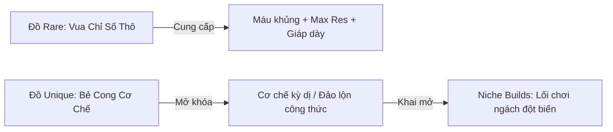

# 14. Thiết Kế Trang Bị Độc Bản (Unique Items) Cho Các Niche Builds

**Tài liệu Thiết Kế Hệ Thống Trang Bị Độc Bản & Lối Chơi Ngách (GDD - Unique Items & Niche Builds Specification)**  
**Dự án:** *Idle Exile*  
**Vị trí:** Senior Game Systems & Combat Designer  
**Form Factor:** Mini-Window Desktop Companion (`640 x 320` px Compact đến `640 x 780` px Expanded)  
**Tài liệu liên quan:** [05_items_and_crafting.md](05_items_and_crafting.md), [09_weapon_equipment_system.md](09_weapon_equipment_system.md), [11_equipment_system_design.md](11_equipment_system_design.md), [13_build_archetypes_specification.md](13_build_archetypes_specification.md)

---

## 1. TRIẾT LÝ THIẾT KẾ ĐỒ UNIQUE CHO GAME "ZERO APM"

Trong *Idle Exile*, đồ Unique (màu cam `#AF6025`) tuân thủ nghiêm ngặt nguyên lý kinh điển của *Path of Exile*:
1. **Không Chạy Đua Chỉ Số Thô (Not Stat-Sticks):** Đồ Rare luôn là "Vua chỉ số thô" (Máu tối đa, Kháng tính, Giáp dày). Đồ Unique sở hữu ít hoặc thậm chí không có chỉ số phòng ngự cơ bản.
2. **Khai Mở Cơ Chế (Build-Enabling & Rule-Bending):** Mục đích duy nhất của Unique là **bẻ cong các quy tắc thông thường của game**, tạo ra các phương thức tương tác toán học kỳ dị mà đồ Magic/Rare không bao giờ làm được.
3. **Đánh Đổi Rủi Ro (The Downside Puzzle):** Một món Unique kinh điển luôn đi kèm một cái giá phải trả (nhận sát thương phản vệ, mất ô trang bị, trừ kháng tính, khóa máu). Người chơi phải dùng kỹ năng **Theorycrafting** trên Bảng Nội Tại và các ô trang bị còn lại để giải bài toán này.



---

## 2. MA TRẬN 8 TRANG BỊ UNIQUE ĐỊNH HÌNH 8 NICHE BUILDS

Dưới đây là 8 món trang bị Độc Bản được thiết kế riêng biệt để mở khóa các lối chơi ngách (Niche Builds) vô cùng biến ảo:

```
┌─────────────────────────────────────────────────────────────────────────────────────────────────────────────────┐
│                                    BẢNG MA TRẬN 8 UNIQUE ITEMS CHO NICHE BUILDS                                 │
├──────────────────────────┬──────────────────────┬───────────────────────────────┬───────────────────────────────┤
│ Tên Trang Bị Unique      │ Phôi Gốc & Vị Trí    │ Cơ Chế Bẻ Cong Độc Nhất       │ Niche Build Mở Khóa           │
├──────────────────────────┼──────────────────────┼───────────────────────────────┼───────────────────────────────┤
│ 1. Brutus' Lead Sprinkler│ Ritual Sceptre (1H)  │ +4-7 Fire Dmg per 10 Strength │ Strength-Stacking Fire Slam   │
│ 2. Heartbound Loop       │ Moonstone Ring (Nhẫn)│ Tự nhận 350 Phys Dmg khi đệ tử│ Wardlooper / CWDT Self-Damage │
│ 3. Death's Oath          │ Astral Plate (Áo)    │ Kích hoạt Death Aura (Chaos)  │ Chaos Walking Simulator (0 APM│
│ 4. Shavronne's Wrappings │ Occultist's Vestment │ Chaos Dmg không xuyên qua ES  │ Low-Life Pain Attunement Mage │
│ 5. One With Nothing      │ Small Cluster / Dây  │ Tay không đánh như Dual-Wield │ Hollow Palm Unarmed Brawler   │
│ 6. Bino's Kitchen Knife  │ Slaughter Knife (Dao)│ Độc lây lan và hồi máu cực lớn│ Toxic Epidemic Proliferation  │
│ 7. Indigon               │ Hubris Circlet (Mũ)  │ Tăng vọt Spell Dmg theo Mana  │ Infinite Mana Rampage Caster  │
│ 8. The Baron             │ Close Helmet (Mũ)    │ Zombie hút máu về cho Exile   │ Strength-Stacking Zombie King │
└──────────────────────────┴──────────────────────┴───────────────────────────────┴───────────────────────────────┘
```

---

### 1. BRUTUS' LEAD SPRINKLER (RITUAL SCEPTRE — 1H)

* **Phôi gốc:** Ritual Sceptre (Implicit: `+25% to Elemental Damage`).
* **Thuộc tính Độc Bản:**
  ```text
  • Adds (4 to 7) Fire Damage to Attacks with this Weapon per 10 Strength
  • 20% increased Attack Speed
  • No Physical Damage (Không thể gây sát thương Vật lý)
  • -10% to all Elemental Resistances
  ```
* **Niche Build Mở Khóa:** **The Strength-Stacker Slammer**.
* **Cơ chế Vận Hành:**
  * Thay vì phụ thuộc vào Flat Physical của vũ khí, người chơi tập trung lấy toàn bộ các node `+10 Strength` và `% Increased Strength` trên cây Marauder/Duelist, đẩy Strength lên **1,200 – 1,500 điểm**.
  * Cây chùy tự động cộng thêm **$(1200 / 10) \times (4 \sim 7) = 480 \text{ đến } 840 \text{ Flat Fire Damage}$** vào đòn đánh!
  * Vừa sở hữu lượng Máu khổng lồ từ Strength (1,200 Str = +600 Flat Life), vừa có DPS Hỏa bộc phát kinh hoàng.
* **Cái Giá Phải Trả (Downside):** Bị trừ 10% kháng tính toàn nguyên tố và không gây được sát thương vật lý (vô tác dụng với các bổ trợ Bleed/Phys).

---

### 2. HEARTBOUND LOOP (MOONSTONE RING — ACCESSORY)

* **Phôi gốc:** Moonstone Ring (Implicit: `+25 to Maximum Energy Shield`).
* **Thuộc tính Độc Bản:**
  ```text
  • You take 350 Physical Damage when a Minion dies or expires
  • +30 to Maximum Life
  • 15% increased Minion Maximum Life
  • 10% reduced Mana Cost of Skills
  ```
* **Niche Build Mở Khóa:** **The Self-Damage Wardlooper / CWDT Autobomber**.
* **Cơ chế Vận Hành:**
  * Đây là cơ chế kỳ dị bậc nhất của PoE được đưa vào *Idle Exile*: Exile triệu hồi các đệ tử có vòng đời ngắn (như *Summon Raging Spirits* hoặc *Skeletons* tồn tại 3 giây).
  * Mỗi khi một đệ tử biến mất, chiếc nhẫn ép Exile **tự nhận 350 sát thương vật lý**.
  * Chuỗi sát thương tự thân này lập tức chạm ngưỡng của Support Gem **`Cast when Damage Taken (CWDT)`** (ngưỡng 500 dmg), tự động xả ra hàng loạt phép thuật (*Spark*, *Fireball*, *Frost Bomb*) mà **hoàn toàn không cần quái đánh và không tốn 1 giọt Mana**!
* **Cái Giá Phải Trả (Downside):** Nếu không xây dựng đủ Giáp (Armour) hoặc khả năng hồi phục, Exile sẽ tự nổ tung vì chính đàn đệ tử của mình.

---

### 3. DEATH'S OATH (ASTRAL PLATE — BODY ARMOUR)

* **Phôi gốc:** Astral Plate (Implicit: `+12% to all Elemental Resistances`).
* **Thuộc tính Độc Bản:**
  ```text
  • Triggers Level 20 Death Aura when Equipped
    (Deals 450 Base Chaos Damage per second to nearby enemies in a 50px radius)
  • You take 450 Chaos Damage per second while you have an active Aura
  • +50 to all Attributes
  • 15% increased Attack Speed
  ```
* **Niche Build Mở Khóa:** **The Chaos Walking Simulator (Zero APM King)**.
* **Cơ chế Vận Hành:**
  * Biểu tượng của dân chơi "Lười biếng": Khi mặc áo, một vầng hào quang tử khí màu tím đen tỏa ra xung quanh Exile. Bất kỳ quái vật nào trong phạm vi 50px sẽ tan rã dần bởi sát thương Chaos DoT mà không cần tung đòn.
  * Hào quang ăn theo các chỉ số `% Increased Chaos Damage` và `Chaos Damage over Time Multiplier`.
* **Cái Giá Phải Trả (Downside):** Exile liên tục bị rút 450 Máu/giây bởi sát thương Chaos. Nếu người chơi để Chaos Resistance ở mức âm (-60%), sát thương tự rút là 720 Máu/s (đột tử sau 3 giây). Người chơi buộc phải giải bài toán: Đẩy **Chaos Resistance lên kịch trần 75%** (giảm tự rút về 112 Máu/s) và lấy đủ **Life Regen** để trung hòa.

---

### 4. SHAVRONNE'S WRAPPINGS (OCCULTIST'S VESTMENT — BODY ARMOUR)

* **Phôi gốc:** Occultist's Vestment (Implicit: `10% increased Spell Damage`).
* **Thuộc tính Độc Bản:**
  ```text
  • Chaos Damage does not bypass Energy Shield
  • +150% to maximum Energy Shield
  • 10% less Maximum Life
  • +25% to Lightning Resistance
  ```
* **Niche Build Mở Khóa:** **Low-Life Pain Attunement Caster**.
* **Cơ chế Vận Hành:**
  * Thông thường trong PoE, sát thương Chaos xuyên thẳng qua lớp Energy Shield (ES) để trừ vào Máu, khiến nhân vật Low-Life (dưới 50% Máu) bị hạ gục ngay lập tức.
  * Chiếc áo này **bẻ cong quy tắc**: Khóa chặt sát thương Chaos ở lớp ngoài cùng của Energy Shield.
  * Nhờ đó, người chơi an tâm dùng Aura giam giữ 65% Máu để kích hoạt trạng thái **Low Life**, hưởng trọn vẹn điểm thưởng **`+30% More Spell Damage`** từ Keystone *Pain Attunement* mà vẫn bất tử sau lớp khiên 7,000+ ES.
* **Cái Giá Phải Trả (Downside):** Giảm 10% Máu tối đa và áo hoàn toàn không có chỉ số Giáp hay Né Tránh.

---

### 5. ONE WITH NOTHING (TALISMAN / CLUSTER JEWEL)

* **Phôi gốc:** Onyx Amulet hoặc Phôi Trang Sức Đặc Biệt.
* **Thuộc tính Độc Bản:**
  ```text
  • Counts as Dual Wielding while you have no Gloves, Main Hand, or Off Hand equipped
  • Adds (14 to 20) Physical Damage to Attacks with Unarmed per 10 Dexterity
  • 50% more Attack Speed with Unarmed Attacks
  ```
* **Niche Build Mở Khóa:** **Hollow Palm Unarmed Monk (Dex-Stacking Martial Artist)**.
* **Cơ chế Vận Hành:**
  * "Cao thủ tay không": Nhân vật cởi sạch Vũ khí chính, Vũ khí phụ và Găng tay.
  * Nhận nội tại Dual-Wielding (+10% More APS, +15% Block).
  * Tích lũy **800 – 1,000 Dexterity**: Mỗi 10 Dex cộng thêm tới 14-20 Flat Phys $\rightarrow$ Tạo ra đòn đấm tay không có lượng sát thương gốc lên tới **$1,120 \sim 1,600 \text{ Flat Physical Damage}$** (gấp 5 lần một cây kiếm 2 tay mạnh nhất game)!
* **Cái Giá Phải Trả (Downside Chí Mạng):** **Mất trắng 3 ô trang bị quan trọng nhất**. Người chơi bị thâm hụt nghiêm trọng lượng Kháng tính và Máu vốn thường được tìm thấy trên Găng tay và Khiên/Vũ khí.

---

### 6. BINO'S KITCHEN KNIFE (SLAUGHTER KNIFE — 1H)

* **Phôi gốc:** Slaughter Knife (Implicit: `+40% to Global Critical Strike Chance`).
* **Thuộc tính Độc Bản:**
  ```text
  • On Killing a Poisoned Enemy, nearby Enemies are Poisoned
  • On Killing a Poisoned Enemy, you and nearby allies Regenerate Life
    equal to the strongest Poison stack on the killed target
  • +30% to Damage over Time Multiplier for Poison
  ```
* **Niche Build Mở Khóa:** **The Toxic Epidemic Assassin (Dịch Bệnh Lan Truyền)**.
* **Cơ chế Vận Hành:**
  * Giải quyết nhược điểm dọn quái hành lang của build Độc: Khi một con quái trúng độc ngã xuống, toàn bộ độc tố lây lan tức thì sang bầy quái đi sau (hệt như Ignite Proliferation).
  * Đồng thời biến lượng sát thương độc khủng khiếp thành máu hồi phục: Khiến Exile hồi hàng nghìn Máu/giây trong suốt quá trình càn quét đợt quái.
* **Cái Giá Phải Trả (Downside):** Phôi Dao găm có tầm quét rất hẹp, chỉ phát huy sức mạnh khi đã hạ gục được con quái đầu tiên.

---

### 7. INDIGON (HUBRIS CIRCLET — HELMET)

* **Phôi gốc:** Hubris Circlet (Implicit: Base Energy Shield cao nhất hệ Mũ).
* **Thuộc tính Độc Bản:**
  ```text
  • (50% to 60%) increased Spell Damage for each 200 total Mana you have Spent Recently
  • Mana Costs of Skills are increased by 50% for each 200 total Mana Spent Recently
  • Recover 10% of Maximum Life when you use a Skill that costs Mana
  ```
* **Niche Build Mở Khóa:** **The Infinite Mana Rampage (Archmage God-King)**.
* **Cơ chế Vận Hành:**
  * Tạo nên vòng lặp "Tiêu càng nhiều Mana, sát thương càng tăng vọt": Khi xả phép với tốc độ cao, Mana tiêu hao tăng dần lên hàng trăm, kéo theo chỉ số Spell Damage tăng lũy tiến từ `+100%` $\rightarrow$ `+500%` $\rightarrow$ **`+2,000% Spell Damage`**.
  * Kết hợp với lượng hồi máu khổng lồ trên mỗi lần tiêu Mana.
* **Cái Giá Phải Trả (Downside):** Mana Cost của chiêu có thể vọt lên 800 - 1,200 Mana/lần xuất chiêu. Nếu tốc độ hồi Mana (Mana Regen) không theo kịp, nhân vật sẽ cạn sạch Mana (OOM) và đứng bất động chịu trận.

---

### 8. THE BARON (CLOSE HELMET)

* **Phôi gốc:** Close Helmet (Armour / Energy Shield).
* **Thuộc tính Độc Bản:**
  ```text
  • +2 to Maximum number of Raised Zombies
  • Half of your Strength is added to your Minions
  • With at least 1,000 Strength, 2% of Damage dealt by your Minions is Leeched to you as Life
  ```
* **Niche Build Mở Khóa:** **The Strength-Stacking Zombie King**.
* **Cơ chế Vận Hành:**
  * Cầu nối hoàn hảo giữa hai trường phái: **Strength-Stacking** và **Minion Summoner**.
  * Đẩy Strength lên 1,000: Bầy Zombie nhận thêm 500 Strength (tăng 1,000 HP và 100% sát thương đòn đánh).
  * Đặc biệt: Toàn bộ sát thương của bầy Zombie cắn xé quái vật sẽ tự động **Hút Máu ngược lại truyền vào Exile**! Exile đứng phía sau vừa trâu máu vừa được đệ tử liên tục bơm đầy bình sinh lực.
* **Cái Giá Phải Trả (Downside):** Chiếc mũ không có dòng Kháng tính nguyên tố, ép người chơi phải tìm kháng tính ở các vị trí khác để bù đắp.

---

## 3. KẾ HOẠCH TÍCH HỢP KỸ THUẬT (DATA SCHEMAS & IMPLEMENTATION)

### 3.1. Cấu Trúc Dữ Liệu `data/uniques.json`
Tạo tập tin `data/uniques.json` lưu trữ định nghĩa của các món đồ Độc Bản:

```json
[
  {
    "id": "brutus_lead_sprinkler",
    "name": "Brutus' Lead Sprinkler",
    "baseId": "ritual_sceptre",
    "gearSlot": "MainHand",
    "itemLevel": 28,
    "uniqueModifiers": [
      { "stat": "flat_fire_per_10_strength_min", "value": 4.0 },
      { "stat": "flat_fire_per_10_strength_max", "value": 7.0 },
      { "stat": "local_attack_speed", "mod": "increased", "value": 20.0 },
      { "stat": "deal_no_physical_damage", "mod": "override", "value": 1.0 },
      { "stat": "all_elemental_resistances", "mod": "flat_percent", "value": -10.0 }
    ],
    "flavorText": "The heavier the blow, the hotter the flame."
  },
  {
    "id": "deaths_oath",
    "name": "Death's Oath",
    "baseId": "astral_plate",
    "gearSlot": "BodyArmour",
    "itemLevel": 62,
    "uniqueModifiers": [
      { "stat": "grants_death_aura", "mod": "trigger", "value": 1.0, "dps": 450.0, "radius": 50.0 },
      { "stat": "self_chaos_damage_per_second", "mod": "degen", "value": 450.0 },
      { "stat": "all_attributes", "mod": "flat", "value": 50.0 }
    ],
    "flavorText": "Only those who embrace death may command it."
  }
]
```

### 3.2. Cập Nhật Core Engine (`src/Core/Services/DamageCalculator.cs` & `PlayerState.cs`)
* Tích hợp hook đọc thuộc tính Unique:
  * `ComputeAttributeStackingModifiers()`: Quét các trang bị có stat dạng `per_10_strength` hoặc `per_10_dexterity` để cộng sát thương trực tiếp vào Base Damage.
  * `EvaluateSpecialUniqueRules()`: Kiểm tra cấm sát thương vật lý (`deal_no_physical_damage`), cấm Chaos xuyên khiên (`chaos_does_not_bypass_es`), hoặc hào quang tự đốt máu (`self_chaos_damage_per_second`).
